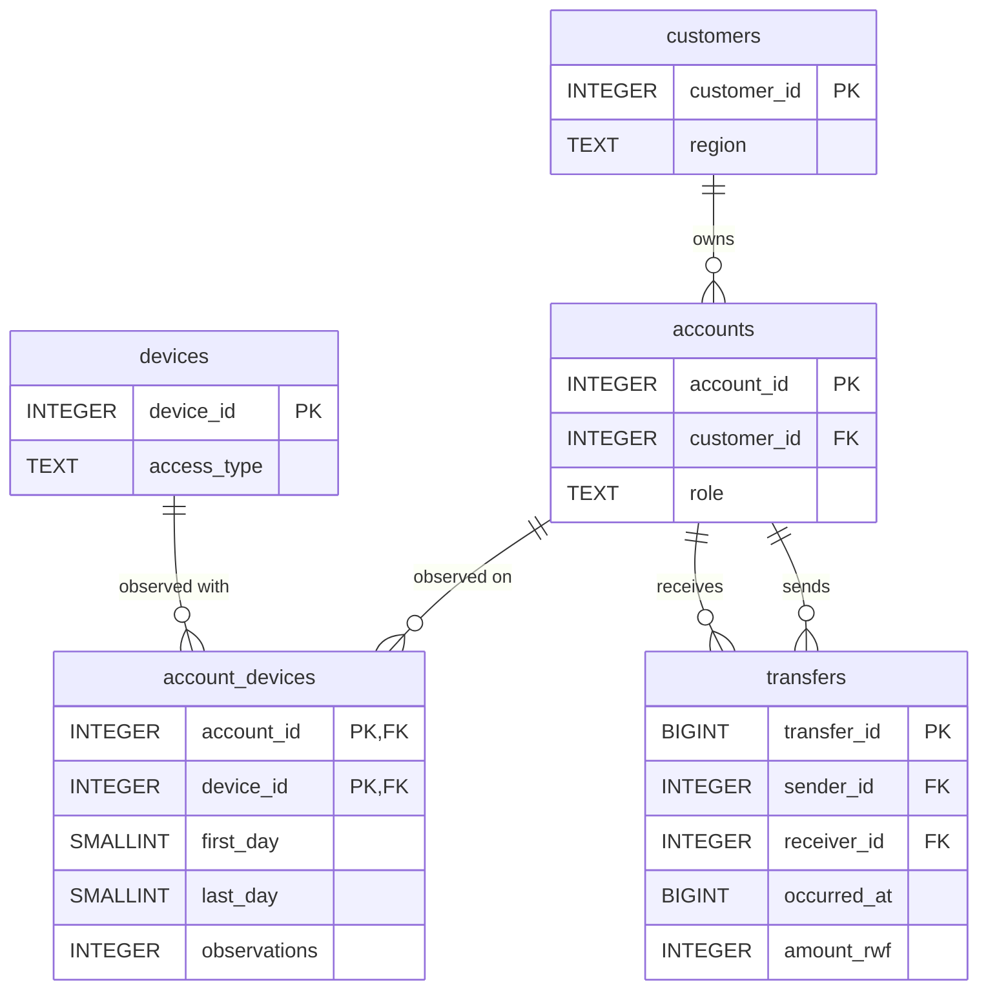
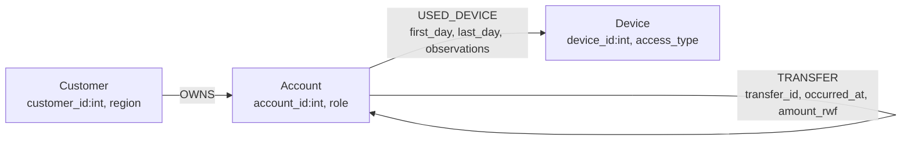

# Report guide — what to capture and what to explain, section by section

Use this as a checklist while you run the programs on **your** machine. The
numbers marked *sandbox* came from a test run on a 2-CPU / 7 GB Linux box with
PostgreSQL 16; your timings will differ, but every **answer** (counts, IDs,
lengths) must match, because the data are fixed. Write all explanations in your
own words — the bullets below are pointers, not report text.

---

## 1.1 Workspace [2]
Screenshot: `python env_info.py` output (both "connection OK" lines, versions,
CPU, RAM, OS, `shared_buffers`, `work_mem`, Neo4j heap/page cache, `timezone = Africa/Kigali`).

## 1.2 Capture [5]
Screenshots: `capture.py --preview` and the final totals block.
Expected: 20,993,500 records; transfer audit count 20,003,300, earliest
1788235200 (01 Sep 06:00:00 CAT), latest 1790798399 (30 Sep 21:59:59 CAT),
sum 231,482,327,870 RWF. CSV total ≈ 0.80 GB. *Sandbox capture ≈ 47 s.*

## 2.1 Schema [4]
Relational schema diagram (render at mermaid.live or redraw):

Field meanings/units are commented in `sql/01_schema.sql`. Screenshot `\d+` of
each table and the constraint list from `04_checks.sql`.

## 2.2 Load and check [5]
Report load seconds (02) and constraint/index seconds (03) separately.
*Sandbox: load ≈ 8.4 s (transfers 8.1 s); constraints + indexes ≈ 58 s.*
Sizes (sandbox): transfers data 1.21 GB, indexes 2.43 GB; database 3.73 GB.
Point worth making: the two covering transfer indexes are twice the table size.

## 3.1 Graph mapping [4]

Field map: customers.* → Customer; accounts.account_id/role → Account,
accounts.customer_id → OWNS (start node); account_devices row → one USED_DEVICE
with its three properties; transfers row → one TRANSFER (sender = start,
receiver = end). Repeated payments stay separate relationships.

## 3.2 Import [5]
Screenshots: import completion (from `prepare_import.py --run`),
`neo4j_checks.py --setup` (constraints/index ONLINE), `neo4j_checks.py`
(704,600 nodes / 20,536,900 relationships, roles, 0 accounts without one owner,
transfer count = distinct transfer_id, audit equal to capture), store and
transaction-log GB. Then run `--cleanup`.

## 3.3 One account in both models [3]
`python inspect_account.py 998`. Explain: a foreign key value (accounts.customer_id)
becomes a stored relationship (OWNS) — the join is materialised as a pointer.
If repeated payments were collapsed into one edge you would lose each event's
time, amount and ID, so Q1/Q2 totals, the Q5 600-second and amount rules and the
Q6 time ordering could no longer be evaluated.

## 4 Routine questions
Hour boundaries are computed in `config.hour_bounds()` (09:45 inclusive → 10:45 exclusive CAT).

**Q1 [3]** Expected (count, RWF): A (1, 200,000) · B (1, 1,050,000) · C (1, 300,000) ·
D (1, 45,000) · E (1, 40,000) · F (1, 30,000). Outgoing value ≠ balance: no opening
balance, inflows, fees, cash-in/out or reversals are in the data.

**Q2 [3]** 30 rows; counts ≈ 666,666–667,000 per day; sum must equal 231,482,327,870.
Chart: `results/charts/q2_daily.png`. A visible pattern: daily value is higher on
6–15 September while counts barely move — a small number of large scenario
transfers on those days. Value ≠ revenue: revenue comes from fees/commissions,
which are not recorded.

**Q3 [4]** Row counts A 4, B 9, C 9, D 4, E 9, F 9. Legitimate sharing: household
handset (e.g. 147226 shared by 147226–147230) or a secondary wallet of the same
customer on the owner's phone (998 and 220998). Overlapping intervals only mean
both accounts were seen at some time in the common days, not at the same moment.

## 5 Connected accounts
**Q4 [6]** 24 results (6 sets × depths 4/6/8/10) by region. *Sandbox totals:*
set C grows 146 → 483 → 832 → 1,433 and F 147 → 488 → 837 → 1,426 accounts,
while A/B/D/E plateau (e.g. A 10 → 43 → 175 → 187). Write your prediction
**before** running depths 8 and 10. Weak associations: each extra hop through a
public terminal or replacement handset links people with no relationship to the
review account. Plot: `results/charts/q4_depth.png`; supporting path printed by `compare.py`.

**Q5 [5]** Matches: A 1, B 1, C 1, D/E/F 0. Example (set B):
20000092 147228→155147 13 Sep 10:00:17 CAT 1,050,000 · 20000093 →163066 10:00:57 1,029,000 ·
20000094 →170985 10:01:37 1,008,420. Not proof of same funds: wallets are fungible;
the receiver may have spent existing balance.

**Q6 [5]** Matches: A 1 (length 4), C 1 (length 6), others 0. Example cycle C:
20000229…20000234, 300,000 → 271,176 RWF, 40 s apart, back to 206978.
Further evidence: KYC/relationship between holders, cash-out events, balances,
device of initiation (observations do not say which device made a payment),
complaints/reversals.

**Q7 [6]** Lengths (bound 4 / bound 6): A 3/3, B none/5, C none/5, D 3/3, E none/5, F none/5.
"No route within 4" ≠ no connection (B/C/E/F connect at 5). A route is
structural — different transfers on different dates, amounts ignored — so it is
not evidence that money moved onward.

## 6 Correctness and performance
**6.1 [4]** `compare.py` prints the 61-case table (PG=Neo and reference columns).
`verify_csv.py` checks device 228001 (998 vs 24755), chain A and cycle C from raw CSV.

**6.2 [5]** `benchmark.py` (each engine alone) then `--summary`. *Sandbox PG medians:*
Q1/Q3/Q5/Q6 < 2 ms, Q2 ≈ 2.3–3 s, Q4 d10 ≈ 10–50 ms, Q7 baseline bound 4 ≈ 0.2 s,
bound 6 ≈ 15 s. Plans in `results/plans/`.

**6.3 [5]** Wasted work in the baseline Q7 plan (*sandbox* `pg_Q7-B-b6.txt`):
the recursive union produced 427,955 account-depth states, probed the accounts
index 14.6 million times (60 million buffer hits), and kept expanding after the
destination was reached. Improvement `Q7_SQL_BIDIR`: distinct neighbours only,
forward radius ⌈b/2⌉ from the source and backward radius ⌊b/2⌋ into the
destination, meet in the middle. *Sandbox:* bound-6 ≈ 25–45 ms vs ≈ 15–20 s, all
12 answers identical. Justify correctness: any path of length L ≤ b has a node at
position max(0, L − ⌊b/2⌋) that lies in both balls.

## 7 Concurrency
**7.1 [5]** `loadtest.py` per engine, then `--summary` (16 rows: 2 engines × 2
workloads × 4 client counts). Screenshot Task Manager / htop while 16 clients run.
**7.2 [4]** Plots `load_throughput_rps.png`, `load_p95_ms.png`. Compare 1 vs 16
clients; saturation appears once clients exceed CPU cores (throughput flattens,
p95 rises). Throughput = system capacity; p95 = what one analyst waits.

## 8 Decisions
**8.1 [5]** Each pair is built to look the same structurally — every review
account shares a household handset and a scenario handset (2280xx/2283xx) with
the accounts along its route, and Q7 finds a route in each pair at the same
length. The difference is the transfer behaviour:

| Pair | Q3 devices | Q4 | Q5 | Q6 | Q7 | Evidence summary |
|---|---|---|---|---|---|---|
| A / D | both 4 overlaps incl. scenario handset | similar | A 1, D 0 | A 1, D 0 | both 3 | A: 200,000 RWF moved on in 40-s steps, returned; D: 45,000, payments 2 days apart |
| B / E | both 9 | similar | B 1, E 0 | 0 / 0 | both 5 (bound 6) | B: 1,050,000 RWF chain in 80 s; E: 40,000, slow |
| C / F | both 9 | similar | C 1, F 0 | C 1, F 0 | both 5 (bound 6) | C: 300,000 RWF 6-hop cycle in 3 min 20 s; F: 30,000, slow |

You decide and justify the priority. Ordinary explanation to discuss: a savings
group (ikimina) rotating contributions among members who share a phone. Missing
evidence: KYC links, cash-out, balances, initiating device.

**8.2 [5]** ≤ 500 words, built from your own measurements (Q2 SQL vs Cypher,
Q4/Q7 traversal, load test, load time/storage). Separate *model* benefit
(relationships stored as pointers) from *algorithm* effect (bidirectional SQL
closing most of the Q7 gap). Propose a freshness target (e.g. graph copy ≤ 15
minutes behind) and what stale data would cause.

**8.3 [3]** Each member writes their own 150–200 words on a different finding.
Declare in the contributions list that an AI assistant helped draft code and how
you checked it (the 61-case comparison and the independent reference/CSV checks).

## 9 Submission
README order is the execution order. Final screenshots: `compare.py --q7 bidir`
completion and both services stopped. `verify_generator.py` must print `True`.
